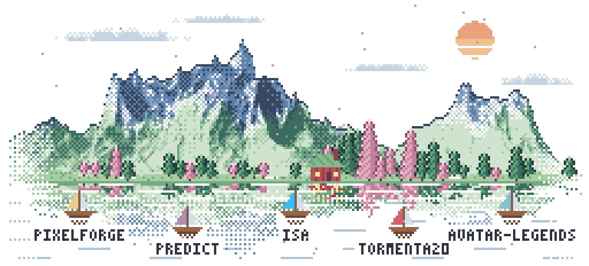
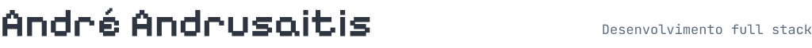
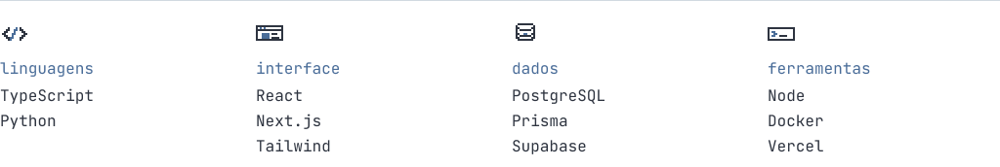

  <picture>
    <source media="(prefers-color-scheme: dark)" srcset="https://raw.githubusercontent.com/andreAndrusaitis/andreAndrusaitis/capa/capa-noite.gif">
    
  </picture>
  <picture>
    <source media="(prefers-color-scheme: dark)" srcset="img/nome-escuro.svg">
    
  </picture>

Desenvolvo aplicações web com TypeScript e Python, do banco de dados à interface. No último ano trabalhei com pixel art gerada por código, simulação de cenários e mesas virtuais de RPG.

Na imagem, cada pinheiro é uma semana de commits e cada barco é um projeto. As estações seguem o calendário do Brasil.

<picture>
  <source media="(prefers-color-scheme: dark)" srcset="img/tecnologias-escuro.svg">
  
</picture>

| | Projeto | O que é | Feito com |
|:---:|---|---|---|
|  | [**pixelforge**](https://github.com/andreAndrusaitis/pixelforge) | Pixel art gerada por código, de PNG a GIF animado | Python |
|  | [**predict**](https://github.com/andreAndrusaitis/predict) | Simulação de cenários com populações sintéticas | TypeScript, Python |
|  | [**isa**](https://github.com/andreAndrusaitis/isa) | Service desk, projetos e documentos em um só lugar | TypeScript |
|  | [**tormenta20**](vitrine/tormenta20/README.md) | Fichas, combate e ferramentas de mestre | TypeScript |
|  | [**avatar-legends**](vitrine/avatar-legends/README.md) | Mesa virtual de RPG com sessão ao vivo | TypeScript |

O código é visível apenas para leitura. Todos os direitos reservados, veja a <a href="LICENSE">licença</a>.
