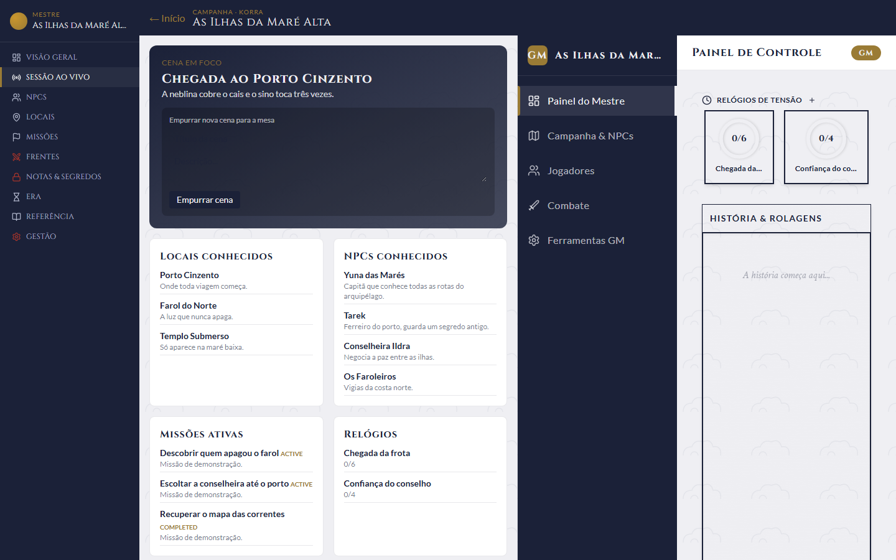
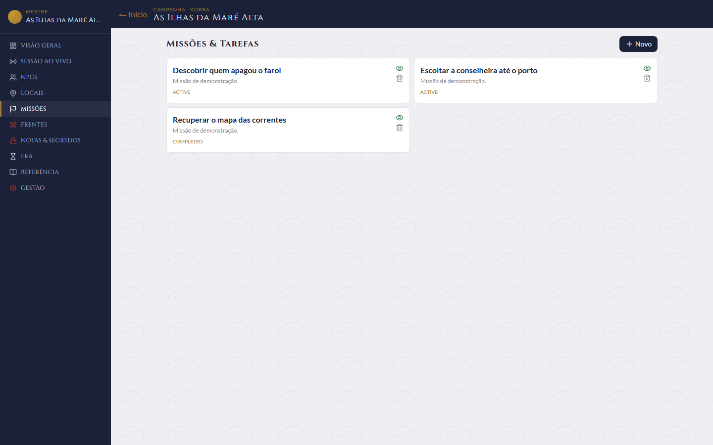
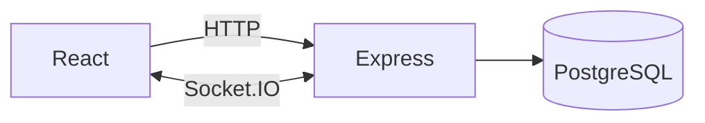

<picture>
  <source media="(prefers-color-scheme: dark)" srcset="capa-escuro.svg">
  
</picture>

Uma mesa virtual para conduzir campanhas de RPG: o mestre prepara personagens, locais e missões e decide, item por item, o que os jogadores já podem ver. Projeto pessoal e sem vínculo oficial com a marca. O código é fechado.

## Sessão ao vivo

Todos os nomes nas imagens são inventados para esta demonstração.

## Preparação

| Personagens | Missões |
|---|---|
|  |  |

## O que tem

- **O mestre revela.** Cada item da campanha nasce privado e só aparece para os jogadores quando o mestre libera.
- **Tempo real.** Cenas, mensagens e relógios chegam à mesa por Socket.IO.
- **Convite por código.** Cada campanha gera um código curto para os jogadores entrarem.
- **Fichas completas.** Equilíbrio, condições, técnicas, inventário e conexões.

## Como é por dentro

React 19, TypeScript, Vite e Tailwind na interface. Express, Socket.IO, Zod e PostgreSQL no servidor. Colunas para o que é buscado e JSONB para a ficha completa.

[Voltar ao perfil](../../README.md)
