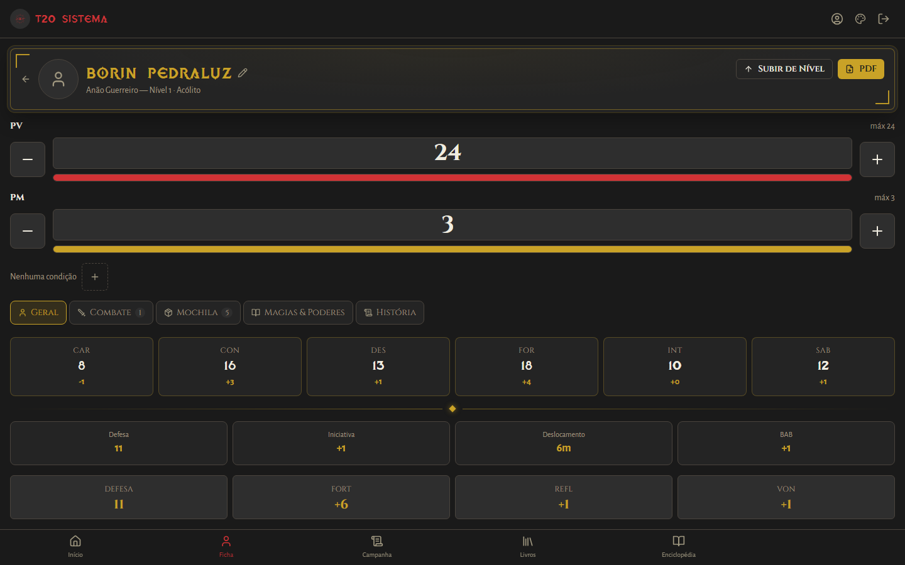
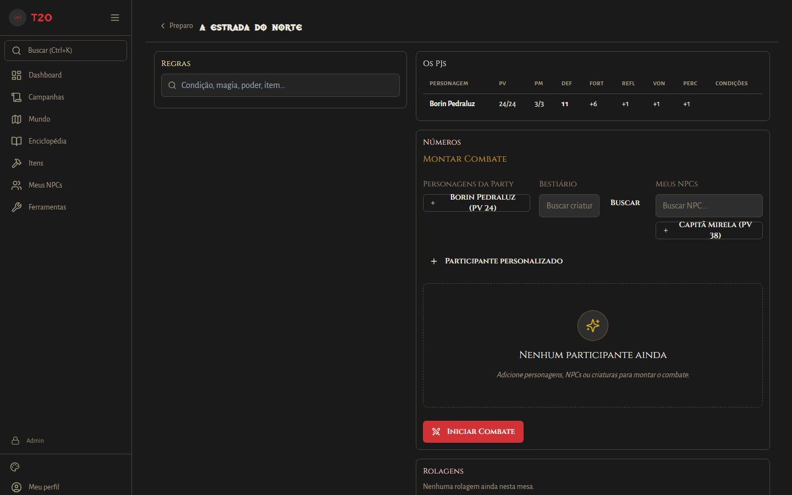
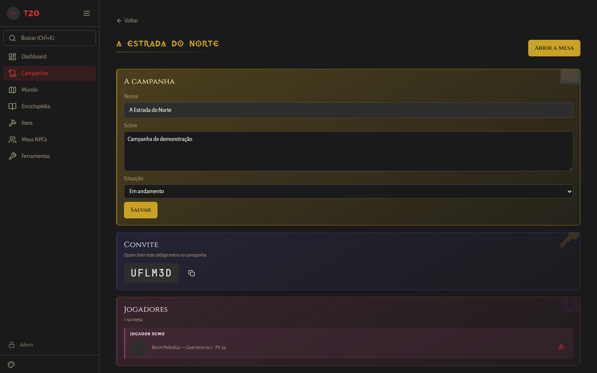
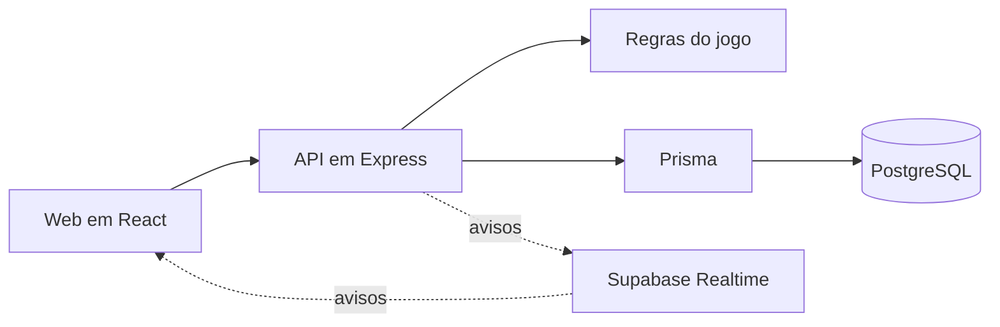

<picture>
  <source media="(prefers-color-scheme: dark)" srcset="capa-escuro.svg">
  
</picture>

Uma plataforma para jogar campanhas de Tormenta20: o jogador cria e evolui a ficha, e o mestre conduz a mesa, monta combates e consulta as regras sem sair da tela. Projeto pessoal e sem vínculo oficial com a marca. O código é fechado.

## Ficha do personagem

Todos os nomes nas imagens são inventados para esta demonstração.

## Para o mestre

| Mesa | Campanha |
|---|---|
|  |  |

## O que tem

- **Criação guiada em nove passos**, com as escolhas validadas no servidor.
- **Números calculados.** Defesa, resistências, vida e mana saem das regras, e a ficha exporta em PDF.
- **Mesa do mestre.** Grupo, combate, rolagens e busca de regras na mesma tela.
- **Ferramentas.** Recompensas, dificuldade de encontros, condições, itens e NPCs próprios.
- **Instalável.** Funciona como aplicativo no celular.

## Como é por dentro

Monorepo em TypeScript com pnpm e Turborepo, pacotes separados para banco e tipos, validação com Zod e mais de 120 arquivos de teste.

[Voltar ao perfil](../../README.md)
